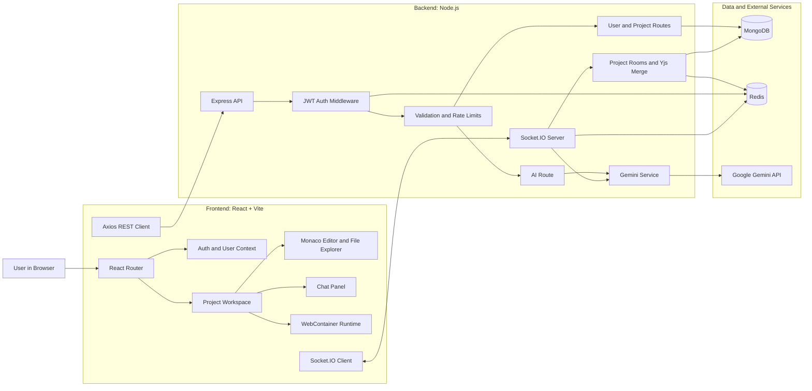
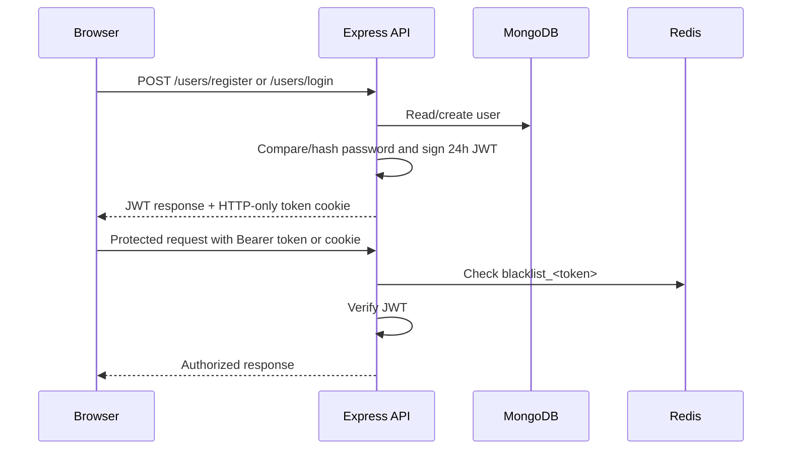
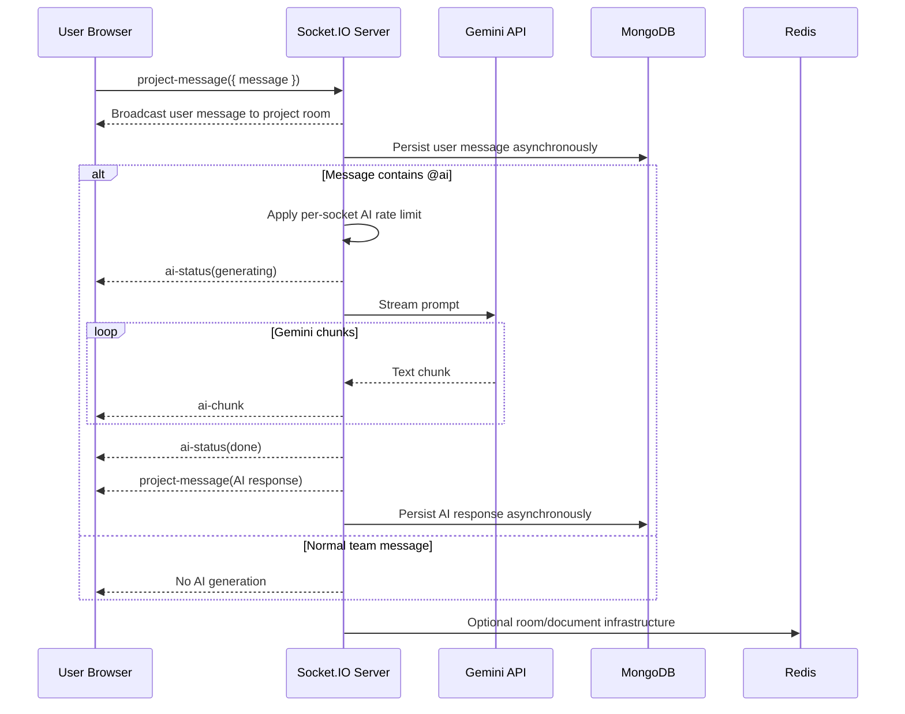
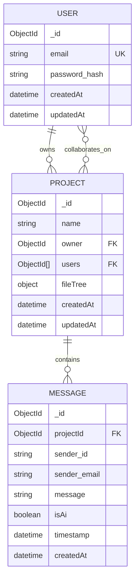
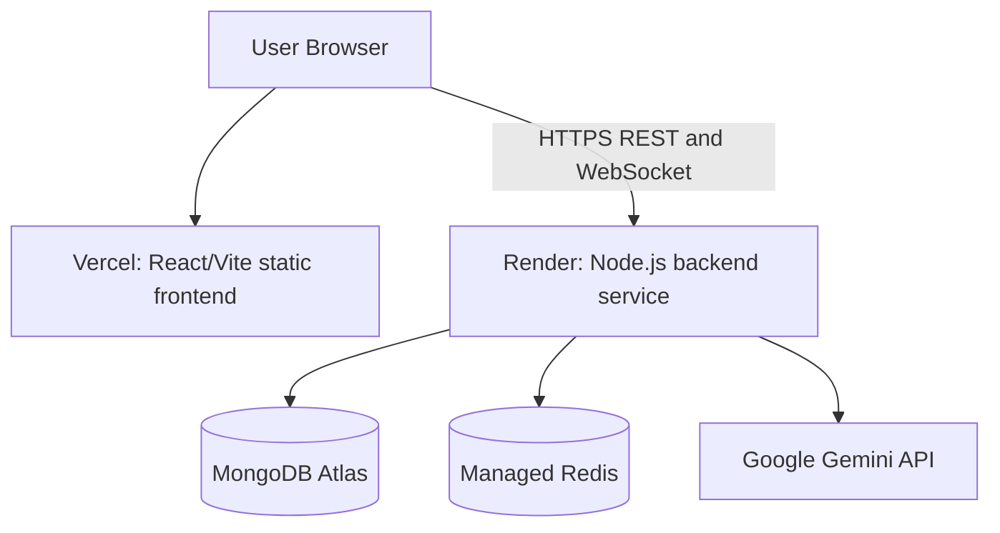

# DevChat System Design

> **Purpose:** This document explains the architecture currently implemented in DevChat.
> It is intended for onboarding, maintenance, and future design discussions.

## 1. System Summary

DevChat is a collaborative AI coding workspace. A user can authenticate, create or
join a project, edit a shared file tree, chat with collaborators, ask Gemini to
generate code, and run the generated project in a browser-based WebContainer.

The system uses:

- **React + Vite** for the single-page frontend
- **Express + Node.js** for REST APIs
- **Socket.IO** for authenticated, project-scoped real-time communication
- **MongoDB/Mongoose** for durable users, projects, file trees, and messages
- **Redis** for token blacklisting, rate-limit support, CRDT snapshots, and
  optional Socket.IO horizontal scaling
- **Google Gemini** for structured code generation and streamed AI responses
- **Yjs** for conflict-free shared document updates
- **WebContainers** for in-browser project installation and execution

## 2. High-Level Architecture

### Main architectural boundary

- **REST is request/response oriented:** authentication, project access, file-tree
  persistence, and historical message retrieval use HTTP endpoints.
- **Socket.IO is event oriented:** live project rooms carry chat messages, AI
  status/chunks, and shared-document updates.
- **MongoDB is the source of durable application data.** Redis contains
  operational/ephemeral state and has in-memory fallbacks for selected features.
- **The WebContainer is client-side execution.** Generated files are mounted and
  run in the user's browser; the backend does not execute generated code.

## 3. Runtime Components

### 3.1 Browser and frontend

The frontend is a React single-page application:

1. `App` creates the `UserProvider` and mounts `AppRoutes`.
2. `UserAuth` protects dashboard and project routes.
3. `Project` loads the selected project and message history through Axios.
4. `initializeSocket(projectId)` opens one Socket.IO connection for the active
   project.
5. The workspace combines:
   - Monaco editor and file explorer
   - Chat panel and collaborator controls
   - WebContainer terminal and preview
   - Yjs-backed shared file editing

Relevant implementation areas:

- [frontend/src/App.jsx](./frontend/src/App.jsx)
- [frontend/src/routes/AppRoutes.jsx](./frontend/src/routes/AppRoutes.jsx)
- [frontend/src/screens/Project.jsx](./frontend/src/screens/Project.jsx)
- [frontend/src/config/axios.js](./frontend/src/config/axios.js)
- [frontend/src/config/socket.js](./frontend/src/config/socket.js)
- [frontend/src/config/webcontainer.js](./frontend/src/config/webcontainer.js)

### 3.2 Backend API

The backend creates an HTTP server around the Express application. The Express
pipeline applies security headers, compression, CORS, body-size limits, cookies,
request logging, and global rate limiting before mounting routes.

| Route group | Responsibility |
|---|---|
| `/users` | Registration, login, profile, logout, and user search |
| `/projects` | Project creation, membership, project reads, file-tree saves, and message history |
| `/ai` | Authenticated and rate-limited non-streaming AI generation |
| `/health` | Process health check |
| `/ready` | MongoDB readiness check |

Relevant implementation areas:

- [backend/app.js](./backend/app.js)
- [backend/server.js](./backend/server.js)
- [backend/routes/user.routes.js](./backend/routes/user.routes.js)
- [backend/routes/project.routes.js](./backend/routes/project.routes.js)
- [backend/routes/ai.routes.js](./backend/routes/ai.routes.js)

### 3.3 Persistence and operational services

#### MongoDB

MongoDB stores:

- **Users:** email, bcrypt password hash, and timestamps
- **Projects:** name, owner, collaborators, file tree, and timestamps
- **Messages:** project, sender, content, AI flag, and timestamps

Indexes support unique user email, project ownership/collaborator lookups, and
chronological message pagination.

#### Redis

Redis is used for:

- JWT blacklist entries created during logout
- Redis-backed rate limiting when configured
- Yjs document snapshots under project/file keys
- Socket.IO pub/sub adapter for multi-instance broadcasts

If Redis is unavailable, the application continues with bounded fallback behavior:
authentication can still verify JWTs, document state can use an in-memory map,
and Socket.IO can use its in-memory adapter.

#### Google Gemini

`ai.service.js` sends prompts to Gemini with a system instruction requiring a
structured JSON response for code-generation requests. The same service exposes:

- a complete-response generation path for `/ai/get-result`
- a streaming path used by Socket.IO `@ai` messages

## 4. Core Request and Event Flows

### 4.1 Authentication flow

Logout stores the token in Redis for its remaining session window and clears the
HTTP-only cookie.

### 4.2 Opening a project workspace

1. The frontend requests `GET /projects/get-project/:projectId`.
2. The backend verifies the JWT and confirms the user belongs to the project.
3. The frontend requests paginated history from
   `GET /projects/:projectId/messages`.
4. The frontend opens Socket.IO with the token and `projectId`.
5. Socket middleware verifies the token, validates the project, checks membership,
   and joins the socket to the project room.
6. The frontend boots the WebContainer independently in the browser.

### 4.3 Collaborative chat and AI streaming

AI failures are reported to the room with `ai-error` and an AI fallback message;
the server keeps the socket process alive.

### 4.4 Shared file editing

1. A client emits `document:join` with a validated file name and initial content.
2. The server loads or initializes the Yjs state from Redis.
3. The server acknowledges the current encoded document state.
4. A client emits `document:update` with a base64 Yjs update.
5. The server validates the file name and 2 MB state limit.
6. The server merges the update with the current Yjs document, stores the merged
   state, and broadcasts it to the other room members.
7. The project file tree can also be saved durably through
   `PUT /projects/update-file-tree`.

### 4.5 Running generated code

1. The AI response provides a structured `fileTree` and optional run commands.
2. The frontend validates and converts the tree to the WebContainer format.
3. The browser mounts the tree into WebContainer.
4. The browser installs dependencies and starts the generated command.
5. Terminal output and the preview remain inside the browser sandbox.

## 5. Data Model

Redis document state is keyed by project and encoded file name:
`crdt:<projectId>:<fileName>`.

## 6. Security and Reliability Controls

- JWTs expire after 24 hours and are accepted through a Bearer header or cookie.
- Logout blacklists the token in Redis.
- Socket connections require both a valid token and project membership.
- CORS is restricted through the backend CORS configuration.
- Helmet, compression, request logging, and disabled `x-powered-by` are enabled.
- Express body parsing is capped at 10 MB.
- Authentication, AI, sensitive project actions, and general requests are
  rate-limited.
- File-tree writes are capped at 5 MB and reject generated artifact directories
  such as `node_modules`, `.git`, `dist`, and `build`.
- Shared document names reject traversal segments and document states are capped
  at 2 MB.
- `/ready` reports `503` until MongoDB is connected.
- SIGTERM and SIGINT perform graceful HTTP, MongoDB, and Redis shutdown.

## 7. Deployment Topology

The documented production topology separates the frontend and backend:

The frontend receives `VITE_API_URL` at build time. The backend receives
`CLIENT_URL` and validates production secrets before starting.

## 8. Scaling and Trade-offs

### Current scaling strategy

- MongoDB indexes support project membership and message history reads.
- Redis Socket.IO adapter allows room broadcasts across backend instances.
- Redis-backed CRDT snapshots allow document state to be shared between instances.
- Asynchronous message persistence keeps chat delivery independent from a slow
  database write.
- WebContainer execution scales with the user's browser rather than backend CPU.

### Important trade-offs

- The file tree is stored as a MongoDB mixed object, which is simple for project
  snapshots but less granular than a dedicated file collection.
- Redis fallback maps are process-local; they are suitable for development and
  degraded operation, not a durable replacement for Redis.
- Socket chat is delivered in real time, while historical recovery comes from
  MongoDB message pagination.
- AI generation depends on an external provider and is protected with rate limits
  and explicit error events.

## 9. Source of Truth

This design is based on the implementation in:

- [README.md](./README.md)
- [backend/app.js](./backend/app.js)
- [backend/server.js](./backend/server.js)
- [backend/services/redis.service.js](./backend/services/redis.service.js)
- [backend/services/ai.service.js](./backend/services/ai.service.js)
- [backend/models/user.model.js](./backend/models/user.model.js)
- [backend/models/project.model.js](./backend/models/project.model.js)
- [backend/models/message.model.js](./backend/models/message.model.js)
- [frontend/src/screens/Project.jsx](./frontend/src/screens/Project.jsx)

